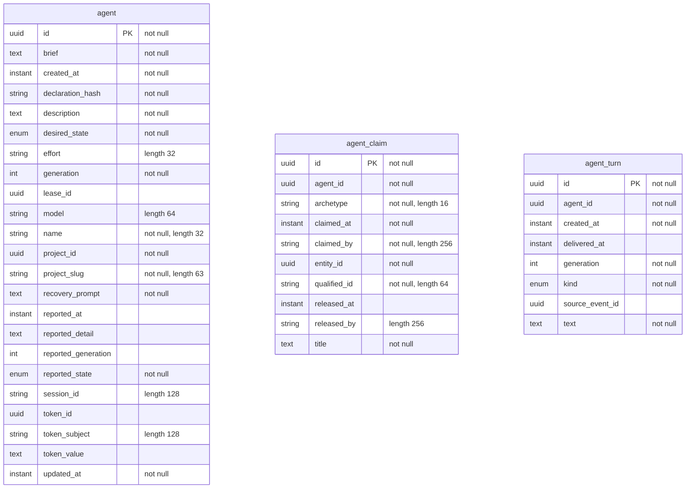

<!-- Generated by `qits database diagram` (jpa). Do not edit: the entity-diagram automation rewrites this file on every release request fold. -->
# Persistence unit `agents`

Datasource `agents` · package `eu.wohlben.qits.agents.service.entity` · 3 entities

